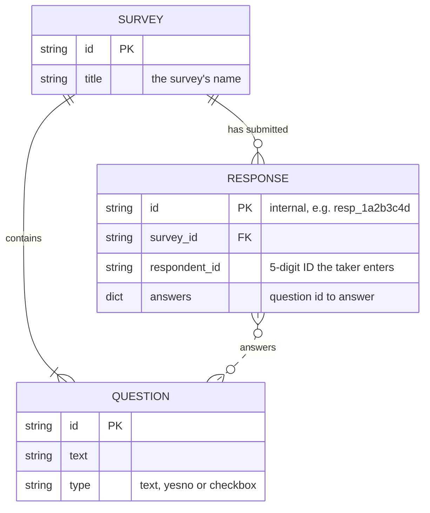

# Survey Manager: Key Data at a Glance (Teaching Edition)

A survey holds its questions. Responses belong to one survey and hold answers
keyed by question id. See [data-model.md](data-model.md) for every field and how
each is stored.

**How to read it:** `||--|{` means one survey contains one or more questions.
`||--o{` means one survey has zero or more responses. The dotted line means
responses point to questions by putting each question's id in their `answers`
keys; a question the respondent left blank has no entry.
