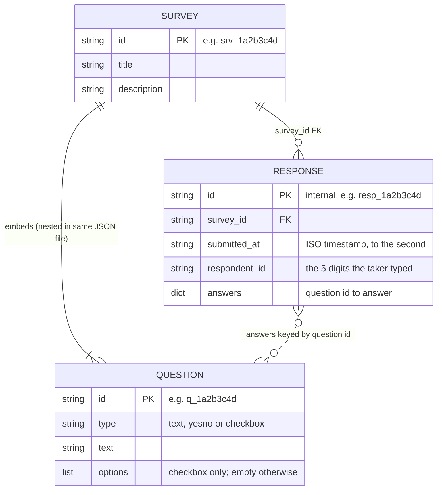

# Survey Manager Data Model (Teaching Edition)

Entities persisted by `src/storage.py` and their relationships, derived from
`src/models.py`, the storage functions themselves, and `build_response_answers`
in `src/form_logic.py`.

## Where each entity is stored

| Entity | File | Written by | Read by |
|---|---|---|---|
| `Survey` (with its `Question`s) | `surveys/<survey_id>.json` | `save_survey` | `load_survey`, `list_surveys` |
| `Response` | `data/responses/<survey_id>/<response_id>.json` | `save_response` | `load_responses` |

Both paths are relative to the repository root (`SURVEYS_DIR` and `RESPONSES_DIR`
in `storage.py`).

## Notes

This is file storage, not a database, so a few things the diagram above
can't show on its own:

- **`QUESTION` isn't a separate store.** It only exists nested inside a
  `SURVEY`'s own JSON file — there's no `questions/` directory and no
  `load_question`/`save_question` function. It's shown separately above only
  because `RESPONSE` answers reference `Question.id`, not because it's
  independently persisted. A survey always has at least one question: the
  Maker refuses to save one without any (`assemble_questions_from_state`).
- **`survey_id` is the actual foreign key, enforced by directory layout,
  not a constraint.** `save_response` writes to
  `data/responses/<survey_id>/<response_id>.json` — the FK is "which folder
  this file lives under." The `survey_id` field inside the file repeats it,
  but `load_responses` finds responses by folder, not by that field. The app
  has no way to delete a survey, so orphaned response folders only appear if
  someone deletes a survey file by hand.
- **`answers` keys are question ids, and the values depend on the question
  type.** `text` → a string (whitespace stripped), `yesno` → `"Yes"` or
  `"No"`, `checkbox` → a list of the selected options. An unanswered question
  is left out of `answers` entirely, not stored as `None`, `""` or `[]` (see
  `build_response_answers` in `form_logic.py`). So a response can have fewer
  `answers` entries than its survey has questions.
- **`RESPONSE` has two ids that mean different things.** `id` is generated by
  the app (`generate_id("resp_")`) and names the file; `respondent_id` is the
  5 digits the person typed and identifies *who* answered. Nothing stops the
  same `respondent_id` from appearing in several responses to one survey.
- **Ids are generated on every save.** Saving the Maker form twice creates two
  surveys with new `srv_...` ids and new `q_...` question ids, even if the
  titles and questions are identical. Titles are not unique.
- **`list_surveys()` returns lightweight dicts, not `Survey` objects.** Each
  is just `{"id": ..., "title": ...}`, sorted by title. To see a survey's
  questions, call `load_survey(survey_id)`.
- **Bad files are skipped, not errors.** A missing or invalid JSON file loads
  as `None` from `load_survey`, and is left out of `list_surveys` and
  `load_responses`. `from_dict` also silently drops keys the dataclass doesn't
  define, so extra fields added to a JSON file by hand are ignored.
